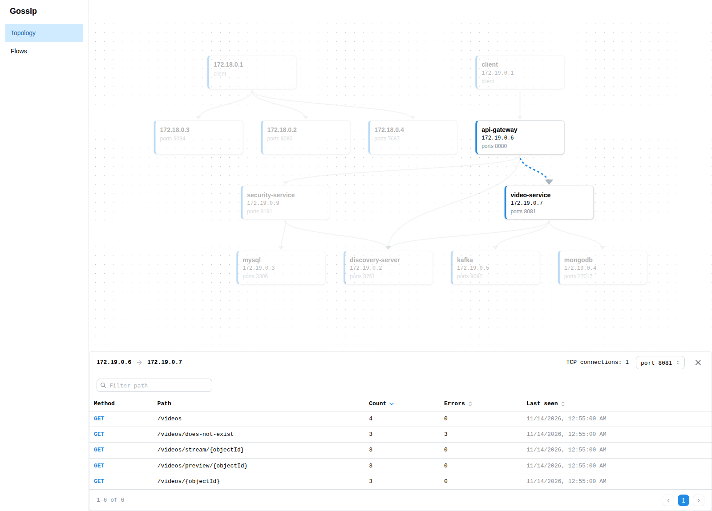
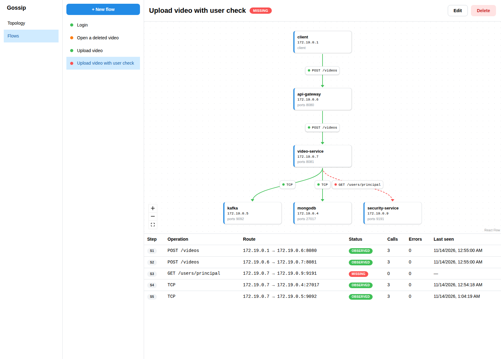

# Gossip

Passive, black-box observability for microservice architectures. An eBPF agent captures TCP connections and HTTP traffic at the Linux kernel level, without changing application code, and sends them through Kafka to a collector that builds a service communication graph in Neo4j.

```
gossip-agent (eBPF, Go) → Kafka → gossip-collector (Kotlin) → Neo4j → gossip-api (Kotlin) → gossip-frontend (React)
```
The observed demo system is [streaming-service](https://github.com/zstojkovic00/streaming-service), a separate repository. Clone it into `streaming-service/`:

```
git clone https://github.com/zstojkovic00/streaming-service.git
cd streaming-service && mvn compile jib:dockerBuild
```

From this observed communication alone, Gossip draws the topology of the system and the operations on every connection.



Gossip as well attempts semantic validation of business processes: an architect describes a process as a **flow** of calls between services, and Gossip checks it against the observed communication at the level of patterns, not individual requests. In the upload flow below it, video-service never calls security-service, so that step is marked as missing.



See [How Gossip works](docs/how-it-works.md) for the topology view, flows, the flow editor.

## Components

| Module | Language | Role |
|---|---|---|
| gossip-agent | Go + eBPF (C) | hooks the kernel, captures TCP connections and HTTP requests, publishes them to Kafka |
| gossip-collector | Kotlin, Spring Boot | consumes Kafka, resolves paths to route templates (`/videos/{objectId}`), writes services, connections and interactions to Neo4j |
| gossip-api| Kotlin, Spring Boot | REST API for the topology, the operations catalog, flows and conformance |
| gossip-frontend | React, TypeScript | topology view, flow list, flow details and flow editor |

## Quick start

Runs everything from a clean state (infrastructure, collector, API, agent, streaming-service and traffic) and leaves it running:

```
make e2e
make frontend
```

Open http://localhost:5173. Stop everything with `make clear`. The steps below do the same by hand.

## Running

Run every step from the repository root. Long-running processes go in separate terminals and write their output to `logs/`.

### 1. Infrastructure

Starts Kafka, schema registry, Kafka UI and Neo4j. `clear-infra` removes the old volumes for a clean start.

```
make clear-infra
make infra
```

### 2. Collector

```
make gossip-collector 2>&1 | tee logs/gossip-collector.log
```

### 3. API

```
make gossip-api 2>&1 | tee logs/gossip-api.log
```

### 4. Agent

The agent must start before the observed services. It only tracks connections that are established while it is running.

```
make -C gossip-agent build
cd gossip-agent && sudo ./gossip-agent kafka/kafka-config.json 2>&1 | tee ../logs/gossip-agent.log
```

### 5. Streaming service

```
docker compose -f streaming-service/docker-compose.yml up -d
```

Wait until the services register with Eureka (usually 30 to 60 seconds). Repeat until it returns `200`:

```
until [ "$(curl -s -o /dev/null -w '%{http_code}' localhost:8080/videos)" = "200" ]; do sleep 3; done; echo OK
```

### 6. Traffic

Sends a fixed scenario through the API Gateway. The argument is the number of rounds.

```
./e2e/traffic.sh 3
```

Each run is saved to `e2e/runs/<timestamp>/`. `expected.tsv` lists every request the client made (method, path, status, count) and is the ground truth to compare against the graph.

### 7. Frontend

```
make frontend
```

Open the URL printed by Vite, usually http://localhost:5173.


## Stopping

```
make clear
```

Stops the agent and removes the infrastructure and streaming-service containers together with their volumes.
