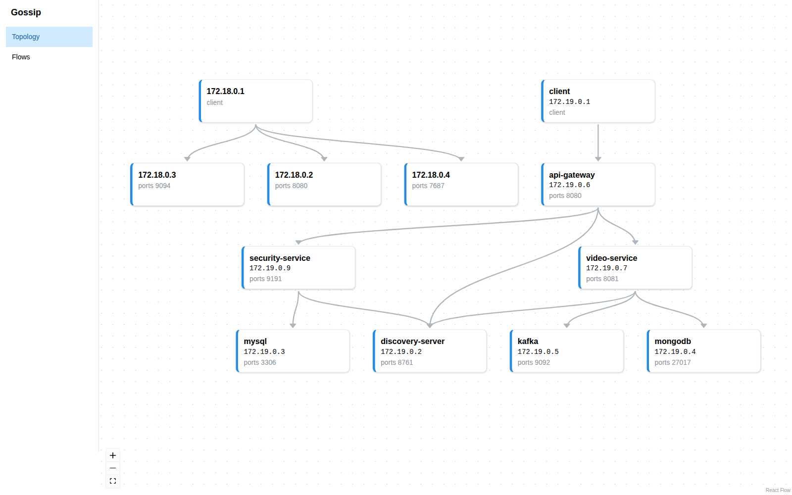
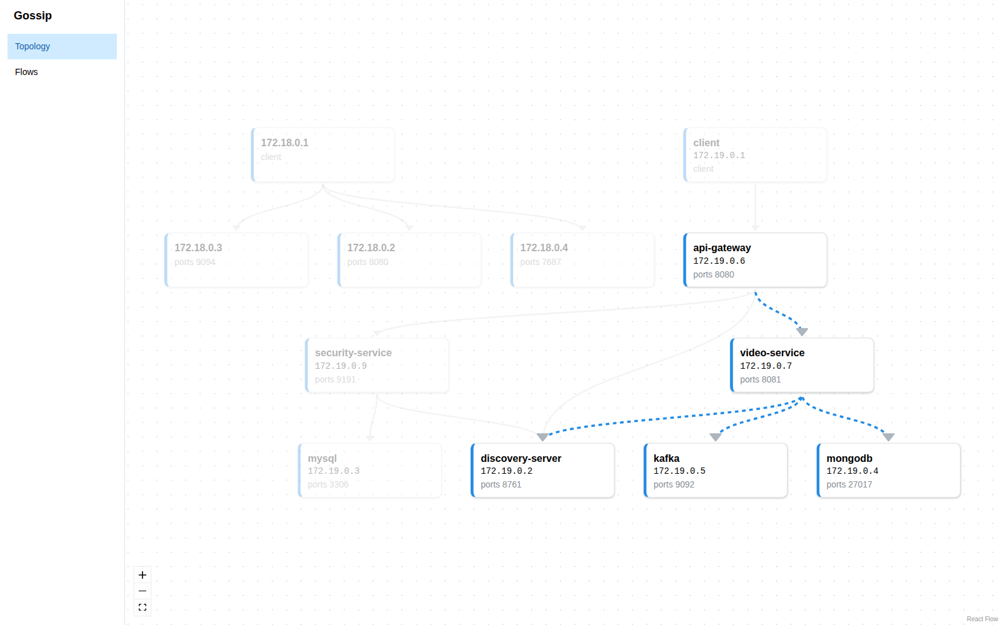
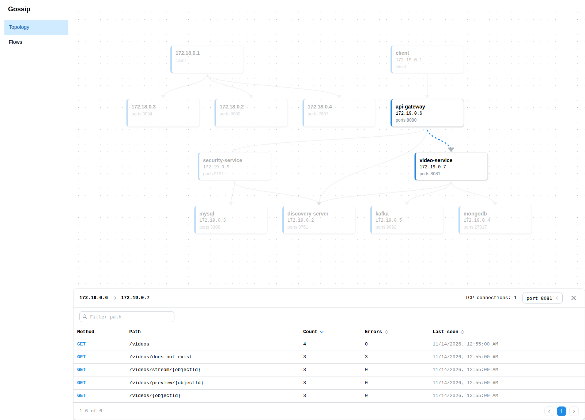
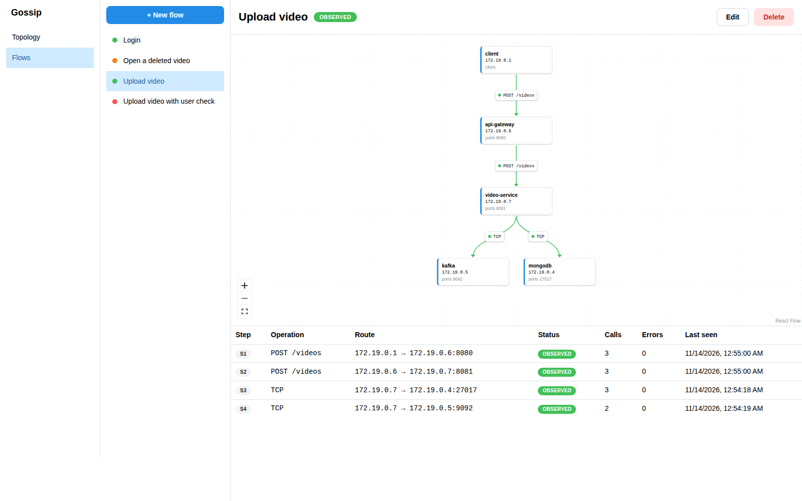
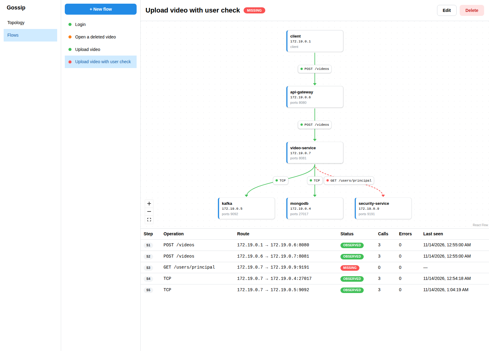
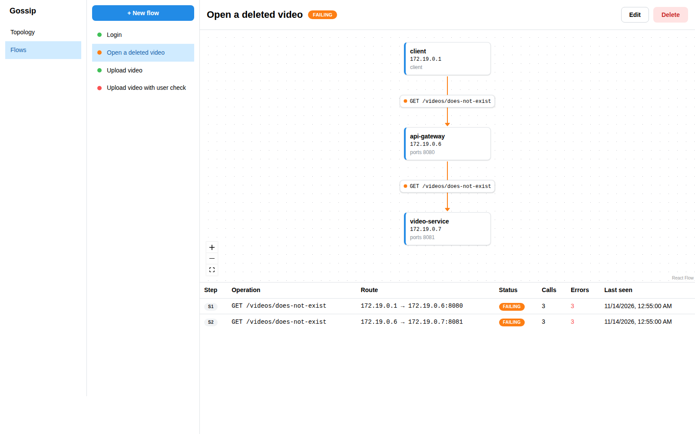
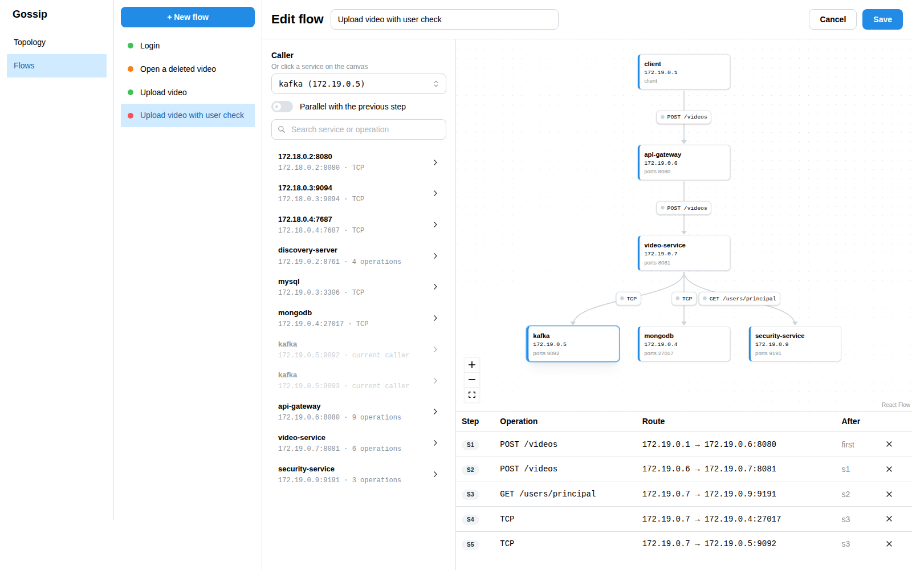

# How Gossip works

## Topology

The topology draws itself, every service that took part in a request appears here, connected to the services it calls, without anyone describing the system by hand.

Clicking a service highlights the services it talks to. Here video-service is called by api-gateway and itself calls discovery-server, Kafka and MongoDB:

Clicking an edge lists the HTTP operations on it, with how many times each was called, how many calls failed and when it was last seen:

## Flows

Monitoring usually looks at APIs one by one: is the endpoint up, how fast is it, how often does it fail. But users don't call endpoints, they do things, like uploading a video. Behind that one action is a chain of calls that together keep a promise: the request goes through api-gateway to video-service, the video is saved to MongoDB, and an event is published to Kafka so the rest of the system knows about it. Each of those calls can look healthy on its own while the process as a whole is broken, because one of them simply never happens.

A **flow** describes such a process: which services call which, and in what order. Gossip sees the system only from the outside, as a black box, and passively captured traffic carries no request ID, so it cannot follow one upload through all of these calls. Instead it checks the flow as a pattern: for every step, whether that kind of call shows up in the observed traffic at all:

Because the check works on patterns, a MISSING step is a reliable sign that the process is broken, while OBSERVED only means that every call the process needs does happen in the system. It does not prove that each single upload went through all of the steps, or in the order the flow describes.

Here the design says video-service checks the user with security-service during an upload, but that call never happens, so the step is missing and the edge is drawn as a dashed red line:

Requests for a video that no longer exists reach video-service, but always end with 404:

## Flow editor

Flows are built from the operations Gossip has already seen, so nobody types IP addresses or paths. Pick who starts the flow, then add operations from the catalog on the left; the service that was just called becomes the next caller. TCP-only targets such as MongoDB and Kafka appear in the catalog as well.

